# DNN Assignment 2: RNN, LSTM, GRU and Transformer

Name: Mohamed Rifayudeen R

Student ID: 2026AK05422

Chosen values: hidden size $h = 128$ (Problem 1), model width $d = 128$ (Problem 2), seeds 7, 21 and 42.

All results come from one run of each notebook on a Colab T4 (PyTorch 2.14.1); every run is a row in `results.csv`. Mean ± std uses the sample std over the three seeds.

## Problem 1: RNN, LSTM and GRU on sequences

### Setup: P1.1 Data pipelines

UCI HAR has train windows of shape (7352, 128, 9) and test windows of shape (2947, 128, 9), from 21 and 9 subjects that do not overlap; labels 1 to 6 become 0 to 5. For each seed, `np.random.default_rng(seed).choice(train_subjects, 4, replace=False)` holds out 4 training subjects for validation (seed 7: 19, 22, 27, 28; seed 21: 8, 14, 21, 23; seed 42: 3, 16, 22, 23). Per-channel mean and std come only from the other 17 subjects. The classes are roughly balanced (Figure 1). The adding problem uses the provided `make_adding` (10,000 / 1,000 / 1,000 sequences, data seeds 0 / 1 / 2). A test checks for every T and split that each sequence has two markers, one per half, and that the target is the sum of the marked values. Predicting 1.0 everywhere gives a test MSE of 0.175, 0.170, 0.168 and 0.153 for T = 50, 100, 200 and 400.

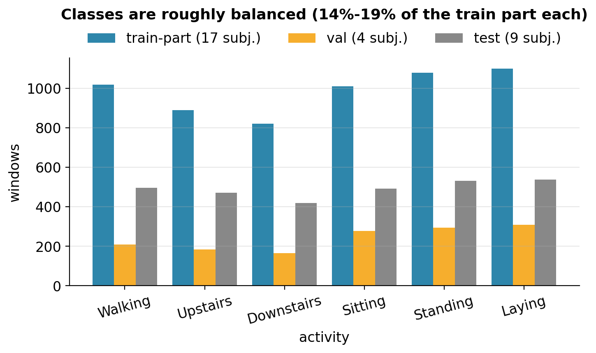

Figure 1. Class counts in the train part, validation and test sets (seed 7 split).

### Verification of the cells: P1.2 RNN, LSTM and GRU cells from scratch

`MyRNNCell`, `MyLSTMCell` and `MyGRUCell` use only matrix products, `sigmoid`, `tanh` and element-wise operations, with PyTorch's gate order and parameter names so weights can be copied over:

$$\begin{aligned}
\text{RNN:}\quad & h_t = \tanh(W_{ih}x_t + b_{ih} + W_{hh}h_{t-1} + b_{hh})\\
\text{LSTM:}\quad & c_t = \sigma(f)\odot c_{t-1} + \sigma(i)\odot\tanh(g),\quad h_t = \sigma(o)\odot\tanh(c_t),\quad [i,f,g,o] = W_{ih}x_t + b_{ih} + W_{hh}h_{t-1} + b_{hh}\\
\text{GRU:}\quad & n_t = \tanh\big(W_{in}x_t + b_{in} + r_t\odot(W_{hn}h_{t-1} + b_{hn})\big),\quad h_t = (1-z_t)\odot n_t + z_t\odot h_{t-1}
\end{aligned}$$

On a random batch ($B = 8$, $T = 128$, $d = 9$) the largest difference to `nn.RNN`, `nn.LSTM` and `nn.GRU` over all outputs and final states is $3.3\times10^{-16}$, $5.6\times10^{-17}$ and $1.7\times10^{-16}$ in float64 (required: $10^{-5}$), and at most $1.6\times10^{-7}$ in float32. A gate block has $h(d+h)+h$ parameters, so a cell with $g$ blocks ($g$ = 1, 4, 3) has $g\,(h(d+h)+h)$. PyTorch stores two bias vectors, $b_{ih}$ and $b_{hh}$, for cuDNN compatibility; only their sum matters, so it reports $g\cdot h$ more (Table 1). The code asserts these counts against `sum(p.numel())`.

Table 1. Parameter counts for $d = 9$, by hand (one bias) and as PyTorch reports them (two biases).

| Cell | $g$ | hand, $h = 64$ | PyTorch, $h = 64$ | hand, $h = 128$ | PyTorch, $h = 128$ |
|---|---|---|---|---|---|
| RNN | 1 | 4,736 | 4,800 | 17,664 | 17,792 |
| LSTM | 4 | 18,944 | 19,200 | 70,656 | 71,168 |
| GRU | 3 | 14,208 | 14,400 | 52,992 | 53,376 |

### HAR results: P1.3 HAR classification

Each classifier is one library recurrent layer ($h = 128$) and a linear layer on the last hidden state. All three use Adam (lr $10^{-3}$), batch 64, 30 epochs and cross-entropy; the test set is evaluated once, at the best validation epoch (Table 2, Figure 2).

Table 2. HAR test results over 3 seeds. Parameters include the classifier head.

| Model | Accuracy | Macro-F1 | Parameters | s/epoch |
|---|---|---|---|---|
| RNN | 0.8057 ± 0.0317 | 0.8028 ± 0.0319 | 18,566 | 0.30 |
| LSTM | 0.9108 ± 0.0133 | 0.9114 ± 0.0141 | 71,942 | 0.39 |
| GRU | 0.9115 ± 0.0061 | 0.9123 ± 0.0069 | 54,150 | 0.30 |

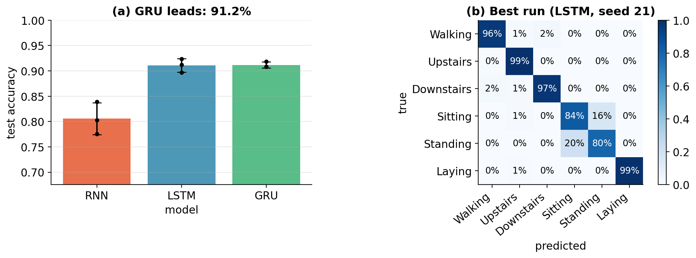

Figure 2. (a) Test accuracy with ±1 std and the three seeds as dots. (b) Row-normalised confusion matrix of the best run (LSTM, seed 21); the largest error is Standing read as Sitting (20%).

### Adding-problem table and curves: P1.4 Adding problem

The regressor is the same layer with a linear output and MSE loss. All three use Adam (lr $10^{-3}$), batch 128, 30 epochs and gradient clipping at norm 1.0. A run is solved when its test MSE is below 0.05 (Table 3, Figure 3).

Table 3. Adding problem test MSE over 3 seeds, with the number of solved runs in brackets.

| Model | T = 50 | T = 100 | T = 200 | T = 400 |
|---|---|---|---|---|
| RNN | 0.1725 ± 0.0030 (0/3) | 0.1700 ± 0.0001 (0/3) | 0.1685 ± 0.0004 (0/3) | 0.1540 ± 0.0004 (0/3) |
| LSTM | 0.0072 ± 0.0040 (3/3) | 0.0887 ± 0.0766 (1/3) | 0.1684 ± 0.0000 (0/3) | 0.1538 ± 0.0002 (0/3) |
| GRU | 0.0013 ± 0.0010 (3/3) | 0.0013 ± 0.0001 (3/3) | 0.0006 ± 0.0001 (3/3) | 0.0282 ± 0.0464 (2/3) |

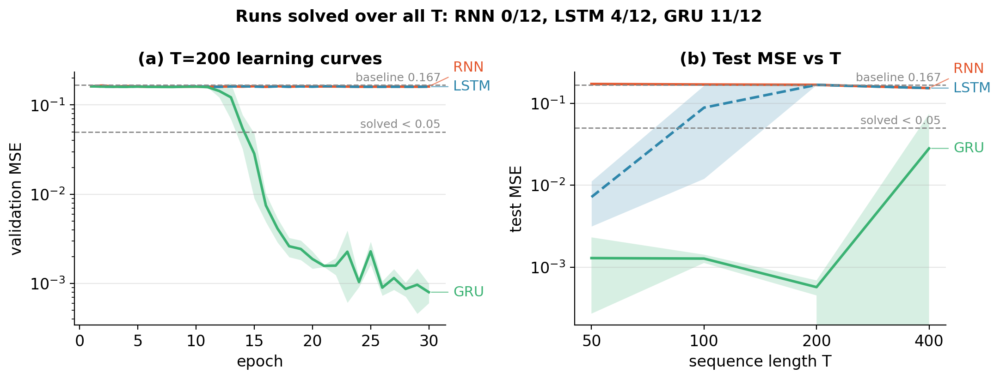

Figure 3. (a) Validation MSE per epoch at T = 200, mean ± std. (b) Test MSE against T (log scale). Grey lines: constant baseline 0.167 and solved threshold 0.05.

### Experiments 5(a) to 5(c): P1.5 Gradients, ablations and analysis

(a) Gradient norm. The library layers hide the recurrence inside one kernel, so I copied the weights of the untrained and of the trained P1.4 model (T = 100, seed 7) into my P1.2 cells, unrolled them on 256 test sequences with `retain_grad()` on every $h_t$, and back-propagated the squared error at the last step (Figure 4, left below).

(b) Hidden size. LSTM and GRU were trained on HAR with $h \in \{16, 32, 64, 128\}$ under the P1.3 protocol (Table 4, Figure 5).

Table 4. Hidden-size sweep on HAR, test accuracy over 3 seeds and parameter count.

| $h$ | LSTM accuracy | LSTM params | GRU accuracy | GRU params |
|---|---|---|---|---|
| 16 | 0.8588 ± 0.0097 | 1,830 | 0.8792 ± 0.0160 | 1,398 |
| 32 | 0.8689 ± 0.0124 | 5,702 | 0.8966 ± 0.0050 | 4,326 |
| 64 | 0.8984 ± 0.0073 | 19,590 | 0.9083 ± 0.0098 | 14,790 |
| 128 | 0.9108 ± 0.0133 | 71,942 | 0.9115 ± 0.0061 | 54,150 |

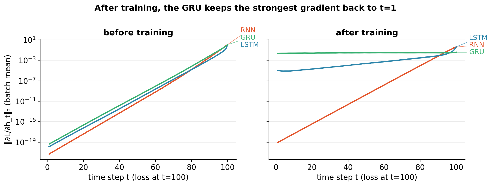

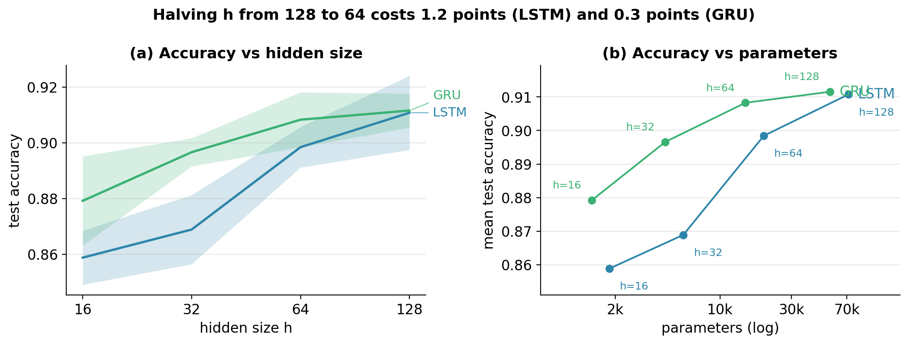

Figure 4 (left). Batch mean of $\lVert\partial L/\partial h_t\rVert_2$ against $t$ at T = 100, before and after training; the loss is at $t = 100$. Figure 5 (right). HAR test accuracy against $h$ and against parameter count.

(c) Ablation. My student ID ends in 2 (even), so I compared gradient clipping at norm 1.0 with no clipping for the vanilla RNN at T = 200. The clipped arm is the P1.4 run; the unclipped arm uses the same seeds, data and budget. Test MSE is 0.1685 ± 0.0004 with clipping and 0.1683 ± 0.0004 without, 0 of 3 runs solved in both arms, and the largest epoch-mean gradient norm before clipping is 1.3 and 1.0 (Figure 6).

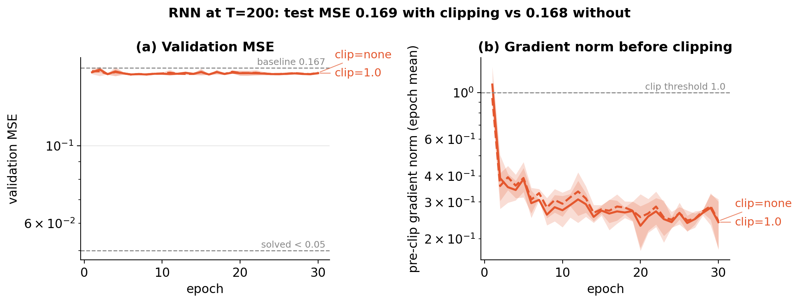

Figure 6. RNN at T = 200 with and without clipping. (a) Validation MSE per epoch. (b) Epoch-mean gradient norm before clipping, with the threshold 1.0.

### One-page analysis: P1.5(d)

Memory. Before training, less than $10^{-19}$ of the gradient reaches $t = 1$ in any model. After training, the gradient at $t = 1$ divided by the one at $t = 100$ is $2.3\times10^{-19}$ for the RNN, $2.3\times10^{-5}$ for the LSTM and 0.58 for the GRU (Figure 4). Only the GRU sends a usable error signal back to the first marker.

Failure as T grows. The RNN never beats the constant baseline (Table 3, Figure 3). The LSTM solves T = 50, one run in three at T = 100 and nothing longer within 30 epochs. The GRU solves every run up to T = 200 and two of three at T = 400, where the failed seed ends at 0.082. The order matches the gradient ratios in Figure 4. Clipping changes nothing for the RNN (Figure 6) because its gradient norm stays near 1, so the clip rarely acts; the RNN fails because almost no gradient reaches the early marker, which clipping cannot fix.

Accuracy, parameters and time. On HAR the GRU and the LSTM are within one std of each other and about 10 points above the RNN (Table 2). The GRU matches the LSTM with 25% fewer parameters and a shorter epoch (0.30 s against 0.39 s). Accuracy drops slowly as $h$ shrinks, and at any parameter count the GRU is above the LSTM (Table 4, Figure 5b).

Wearable choice. I would use the GRU with $h = 64$: 14,790 parameters, 3.7 times fewer than the GRU at $h = 128$ and 4.9 times fewer than the LSTM at $h = 128$, for an accuracy of 0.9083, 0.3 points below the best model (Table 4). It is also the cell that kept long-range memory (Table 3, Figure 4). The RNN is smaller but 10 points less accurate (Table 2). The s/epoch figures are GPU training times, not device energy, so the battery argument rests on parameter count, which sets memory and multiply-adds per step.

## Problem 2: Transformer from scratch

### Attention tests: P2.1 Attention from scratch

`attention(Q, K, V, mask)` computes $\mathrm{softmax}\big(QK^\top/\sqrt{d_k}\big)V$, with masked scores set to $-\infty$. The tests show that every weight row sums to 1 with and without the causal mask, that the output matches `scaled_dot_product_attention` to $4.4\times10^{-16}$ (no mask) and $2.2\times10^{-16}$ (causal) in float64, and that all causal weights above the diagonal are exactly 0. My own 3-token example uses $d_k = 2$:

$$Q = K = \begin{bmatrix}1&0\\0&1\\1&1\end{bmatrix},\quad V = \begin{bmatrix}1&2\\3&4\\5&6\end{bmatrix},\quad \frac{QK^\top}{\sqrt{2}} = \begin{bmatrix}0.7071&0&0.7071\\0&0.7071&0.7071\\0.7071&0.7071&1.4142\end{bmatrix}.$$

For row 1, $e^{0.7071} = 2.0281$ and $e^{0} = 1$; the sum is 5.0562, the weights are 0.4011, 0.1978 and 0.4011, and the output is $0.4011\,[1,2] + 0.1978\,[3,4] + 0.4011\,[5,6] = [3, 4]$. With the other rows done the same way, the weights and outputs without and with the causal mask are

$$A = \begin{bmatrix}0.4011&0.1978&0.4011\\0.1978&0.4011&0.4011\\0.2483&0.2483&0.5035\end{bmatrix},\; AV = \begin{bmatrix}3&4\\3.4067&4.4067\\3.5105&4.5105\end{bmatrix};\quad A_{\text{c}} = \begin{bmatrix}1&0&0\\0.3302&0.6698&0\\0.2483&0.2483&0.5035\end{bmatrix},\; A_{\text{c}}V = \begin{bmatrix}1&2\\2.3395&3.3395\\3.5105&4.5105\end{bmatrix}.$$

The code gives the same matrices within $10^{-4}$.

### Encoder-block tests and parameter count: P2.2 Multi-head and encoder block

`MultiHeadAttention` has four `nn.Linear(d, d)` projections with bias ($W_Q, W_K, W_V, W_O$), reshapes $(B, L, d)$ into $(B, H, L, d/H)$, calls my `attention` and merges the heads. The pre-LN block computes $x \leftarrow x + \mathrm{Dropout}(\mathrm{MHA}(\mathrm{LN}_1(x)))$, then $x \leftarrow x + \mathrm{Dropout}(\mathrm{FFN}(\mathrm{LN}_2(x)))$ with a GELU feed-forward of width $d_{ff} = 4d$; positions use a sinusoidal or a learned encoding. Shape asserts pass, and in a leak test changing tokens after position $t$ leaves the causal block's output at $t$ unchanged (difference 0.0), while without the mask it moves by 0.28 to 0.38. Table 5 matches `sum(p.numel())` in the code.

Table 5. Parameters of one encoder block; in total $4d^2 + 2\,d\,d_{ff} + 9d + d_{ff}$.

| Component | Formula | $d = 128$, $d_{ff} = 512$ |
|---|---|---|
| Weight matrices | $4d^2 + 2\,d\,d_{ff}$ | 196,608 |
| MHA and FFN biases | $4d + d_{ff} + d$ | 1,152 |
| Two LayerNorms | $4d$ | 512 |
| Total | | 198,272 |

### Task A table: P2.3 Encoder classifier on HAR

The window is cut into 16 patches of 8 steps, each patch (72 values) is embedded to $d = 128$, and a CLS token is put in front. A positional encoding, 2 blocks with 4 heads (dropout 0.1), a LayerNorm and a linear head on the CLS token follow. Splits, normalisation and budget are those of P1.3 (Table 6).

Table 6. Transformer on HAR against the best Problem 1 model (3 seeds), including the positional ablation.

| Model | Accuracy | Macro-F1 | Parameters | s/epoch |
|---|---|---|---|---|
| GRU (best of P1.3) | 0.9115 ± 0.0061 | 0.9123 ± 0.0069 | 54,150 | 0.30 |
| Transformer, sinusoidal | 0.9060 ± 0.0112 | 0.9069 ± 0.0114 | 407,046 | 0.84 |
| Transformer, learned | 0.9111 ± 0.0126 | 0.9112 ± 0.0134 | 409,222 | 0.88 |
| Transformer, none | 0.9238 ± 0.0073 | 0.9233 ± 0.0073 | 407,046 | 0.84 |

The sinusoidal Transformer is within one std of the GRU, but it has 7.5 times more parameters and takes 2.8 times longer per epoch. Without positional encoding it scores highest, but with three seeds the gap is one to two std, so the evidence is weak. My untested guess is that each patch already holds its 8 steps in order and the activity depends more on which motion patterns occur than on their order.

### Task B learning curve and bits per character: P2.4 Character language model

The model has a character embedding with sinusoidal positions, 4 pre-LN blocks with 4 heads ($d = 128$, $d_{ff} = 512$, dropout 0.1, causal mask) and a linear output over 65 characters (810,049 parameters). It trains for 5,000 steps on random 128-character windows from the first 90% of the text (batch 64, AdamW with lr $10^{-3}$ and weight decay 0.01, 200-step warm-up, cosine decay, clipping at 1.0). The final validation loss over 50 fixed batches from the last 10% is 1.559 nats, or 2.249 bits per character, against $\ln 65 = 4.17$ nats for a uniform guess (Figure 7).

The three 500-character samples (prompt "ROMEO:", top-k 40, seed 7) are in `generated_samples.txt`. At T = 0.2 the text is grammatical but loops on phrases such as "What is the senators of the world of the country." At T = 0.8 it reads most like Shakespeare, with speaker headings (CLARENCE, MENENIUS) and lines such as "Romeo, sir; yet she cause the behold that we may return.", though it still invents words like "vintoney". At T = 1.5 the spelling breaks down ("PIRDETA", "Arupce", "wath warra homel").

### Heatmaps, ablations and analysis: P2.5 Analysis and ablations

(a) Heads. On the validation line "And you, good sir! Pray, have you not a daughter" I picked the last-layer head with the most weight on the previous character, then the most spread-out of the rest. Head 0 puts 0.45 of its weight on the previous character (entropy 1.08 nats), so it mostly looks one step back; head 3 has entropy 1.75 nats and only 0.20 on the previous character, so it reads widely (Figure 8). Heads 1 and 2 lie between them (1.39 and 1.46 nats).

(b) Number of heads. With 1, 4 and 8 heads at $d = 128$ and 1,500 steps each, the final validation loss is 1.796, 1.783 and 1.805 nats (Figure 7). The 0.02-nat spread comes from one seed, so I name no winner. All three have 810,049 parameters, because the $d \times d$ projections do not depend on the number of heads.

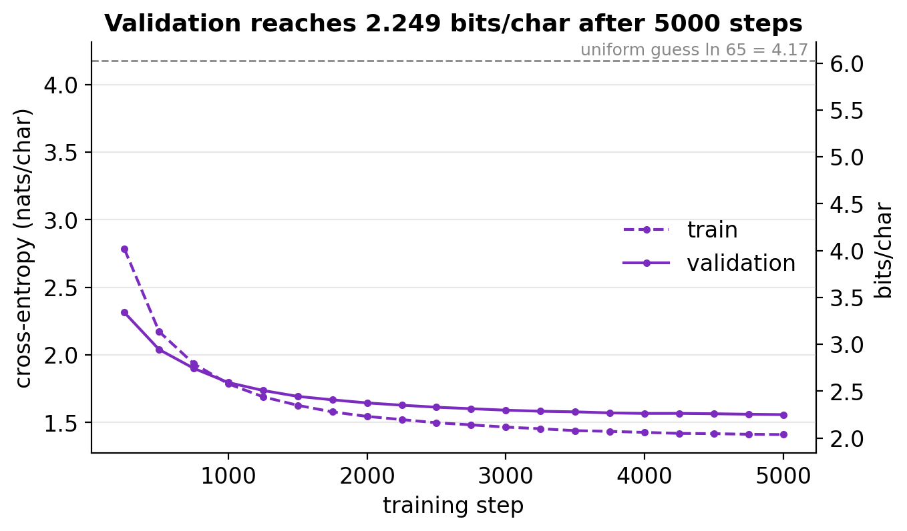

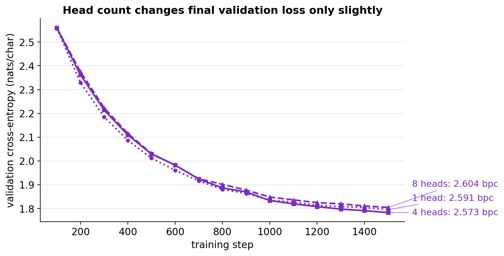

Figure 7. Left: P2.4 train and validation loss over 5,000 steps (right axis in bits per character; dashed line at $\ln 65$). Right: P2.5(b) validation loss for 1, 4 and 8 heads, with the final bits per character.

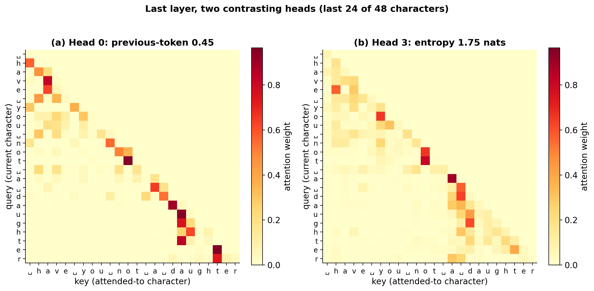

Figure 8. Attention weights of last-layer heads 0 and 3 on the last 24 characters of the line. The upper triangle is zero because of the causal mask.

(c) No causal mask. The same 4-head model trained for 1,500 steps without the mask reaches a train loss of 0.040 nats, against 1.719 with it (Figure 9). Every position can now attend to the character it must predict, so the model copies it, and the validation loss of 0.021 nats is computed by the same leaky model, so it measures nothing. At generation time there are no future characters to copy, and the sample is a colon followed only by newlines.

(d) Context length. One training step of the P2.4 model on batches of $64 \times n$ takes 19.0, 33.2, 85.4 and 242.6 ms and peaks at 202, 407, 950 and 2,766 MB for $n$ = 64, 128, 256 and 512 (Figure 10; mean of 10 steps after 3 warm-up steps, peak memory reset for each $n$). The attention scores cost $O(n^2 d)$ per layer and the projections and feed-forward $O(n d^2)$. The fitted log-log slopes are 1.24 for time and 1.25 for memory, below 2, because at $d = 128$ and these lengths the linear terms still carry much of the cost. Each doubling costs 1.7, 2.6 and 2.8 times more time and 2.0, 2.3 and 2.9 times more memory, so the curves bend toward the quadratic factor of 4.

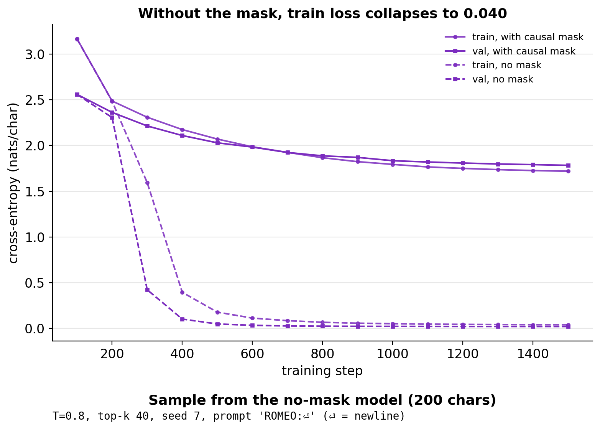

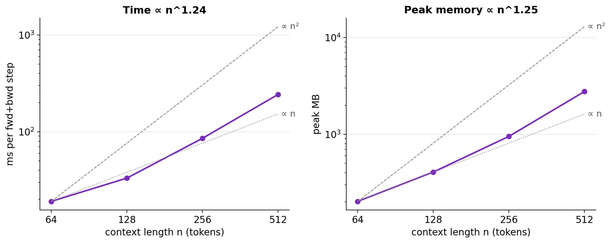

Figure 9 (left). Train and validation loss with and without the causal mask, and a sample from the no-mask model. Figure 10 (right). Time and peak memory per step against context length (log-log), with $n$ and $n^2$ guides.

### Bonus: LSTM-versus-Transformer character model

A 2-layer `nn.LSTM` (embedding 65 × 128, 256 units, dropout 0.1) trained with the same windows, budget, optimiser and evaluation as P2.4 ends at 1.496 nats (2.159 bits/char) against 1.559 nats (2.249) for the Transformer, and trains faster on the T4: 128 s against 165 s, or 320,688 against 248,377 tokens/s. It has 946,625 parameters, 17% more than the Transformer (810,049), which may explain part of the gap. At this size and a context of 128, parallel attention does not beat cuDNN's fused LSTM.

## AI-use statement

I used AI for research, verifications, validation and to look up academical references. Though the AI helped me to build
this project wrt to as a helper. But the project accountability and design, development, execution was done by me. Tools i
used: ChatGPT, Claude, M365 copilot on Microsoft word.

## References

1. D. Anguita, A. Ghio, L. Oneto, X. Parra and J. L. Reyes-Ortiz. A Public Domain Dataset for Human Activity Recognition Using Smartphones. ESANN 2013. UCI Machine Learning Repository.
2. A. Karpathy. Tiny Shakespeare dataset, char-rnn repository, 2015.
3. S. Hochreiter and J. Schmidhuber. Long Short-Term Memory. Neural Computation 9(8), 1997.
4. K. Cho et al. Learning Phrase Representations using RNN Encoder-Decoder for Statistical Machine Translation. EMNLP 2014.
5. A. Vaswani et al. Attention Is All You Need. NeurIPS 2017.
6. PyTorch documentation, `torch.nn.RNN`, `torch.nn.LSTM`, `torch.nn.GRU` and `torch.nn.functional.scaled_dot_product_attention`, version 2.14.
